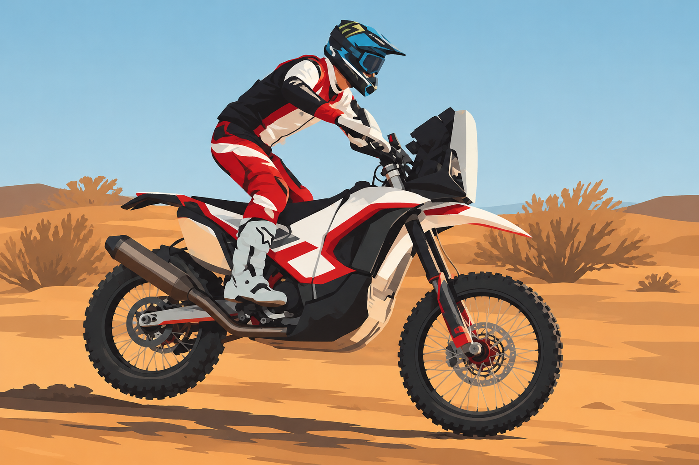

# Athletic Stance and Motorcycle Attack Position: Comparative Biomechanics of Motocross, Rally and Adventure Riding

**Copyright © 2025 Alexey Maximoff. This work is licensed under a Creative Commons Attribution 4.0 International License (CC BY 4.0).**

You are free to copy and redistribute this material in any medium or format, including for commercial purposes, provided that appropriate credit is given to Alexey Maximoff, a link to the license is provided, and any modifications are indicated.

## Abstract

This article examines the biomechanical relationship between the universal athletic readiness posture, known as the **Athletic Stance**, and the specialized motorcycle riding posture commonly referred to as the **Attack Position**.

The analysis covers three off-road motorcycle disciplines:

- **Motocross (MX):** short-duration, high-intensity riding characterized by aggressive acceleration, braking, jumps, landings, rapid directional changes, and frequent vertical impacts.
- **Rally:** prolonged high-speed off-road riding requiring sustained postural control, repeated impact absorption, fatigue resistance, and precise management of the rider–motorcycle system over extended distances.
- **Adventure (ADV) riding:** operation of relatively heavy motorcycles across variable terrain, including loose surfaces, technical obstacles, steep gradients, and situations involving substantial changes in motorcycle balance and inertia.

The central biomechanical principles examined include the hip hinge, posterior kinetic chain activation, pelvic stabilization, lower-limb loading, center-of-mass management, upper- and lower-body movement differentiation, and respiratory-postural integration.

Particular attention is given to the functional contribution of the posterior muscle chain, including the intrinsic foot muscles, plantar flexors, hamstrings, gluteal muscles, spinal extensors, and cervical stabilizers.

A fundamental distinction is established between **anatomical movement patterns** and **technical sport postures**. The Athletic Stance and Attack Position are not instinctive or naturally occurring movement patterns. They are standardized technical models developed to organize the human musculoskeletal system for specific performance requirements.

The analysis demonstrates that the Attack Position shares its fundamental biomechanical architecture with the Athletic Stance but introduces additional requirements associated with controlling an external mechanical system.

Although the underlying movement principles remain consistent across MX, Rally, and ADV riding, their practical implementation differs according to impact intensity, exposure duration, motorcycle mass, terrain, and required control precision.

---

## 1. Introduction

The **Athletic Stance** is widely used as a universal readiness position in invasion sports, ball games, combat sports, and strength training.

Its primary functions include:

- Maintaining postural stability.
- Improving readiness for rapid movement.
- Managing external forces.
- Supporting efficient force production.
- Maintaining the ability to change direction.
- Coordinating the center of mass with the base of support.

The **Motorcycle Attack Position** is a functionally related technical posture used in motocross, rally racing, and adventure motorcycling.

Unlike conventional athletic readiness positions, the rider must control two interconnected mechanical systems:

1. The human musculoskeletal system.
2. The motorcycle, with its own mass, inertia, suspension characteristics, and dynamic behavior.

The rider must maintain postural stability while simultaneously managing the motorcycle's movement through the footpegs, knees, pelvis, and handlebars.

The resulting biomechanical requirements include:

- Vertical impact absorption.
- Fore-aft weight transfer.
- Lateral balance control.
- Pelvic stabilization.
- Independent upper- and lower-body movement.
- Steering precision.
- Sustained muscular endurance.
- Respiratory control under physical and cognitive stress.

The fundamental biomechanical principles are shared across MX, Rally, and ADV riding. However, the magnitude, frequency, and duration of their application differ substantially.

### 1.1. Discipline-Specific Functional Requirements

| Biomechanical requirement | Motocross (MX) | Rally | Adventure (ADV) |
|---|---|---|---|
| Impact absorption | High-intensity, repeated impacts and landings | Repeated impacts over prolonged periods | Variable impacts, often involving heavy motorcycle mass |
| Postural endurance | High-intensity intermittent loading | Prolonged static-dynamic loading | Prolonged riding with variable technical demands |
| Weight transfer | Rapid and aggressive | Continuous and terrain-dependent | Often substantial due to motorcycle mass and inertia |
| Hip hinge | Dynamic and frequently adjusted | Sustained with repeated adjustments | Adapted to obstacles, gradients, and motorcycle geometry |
| Lower-limb function | Impact absorption and rapid repositioning | Continuous stabilization and fatigue management | Stabilization and control of a heavy motorcycle |
| Upper-body independence | Essential during jumps and impacts | Essential for maintaining steering precision and reducing fatigue | Essential for controlling steering inputs without destabilizing the motorcycle |
| Knee-to-motorcycle contact | Frequent and dynamic | Sustained where appropriate | Important for controlling motorcycle movement and mass |
| Respiratory-postural integration | Required under high-intensity exertion | Critical for prolonged endurance | Important during sustained physical and technical loading |

The same fundamental posture must therefore accommodate three different operating environments.

The objective is not to create three unrelated riding positions, but to understand how a common biomechanical architecture is adapted to different mechanical and physiological demands.

---

## 2. Technical Nature of Sport Postures

Sport postures differ from natural movement patterns such as walking, throwing, and spontaneous torso rotation.

They are:

- **Technical constructs:** developed through coaching methodology and practical sporting experience.
- **Normative models:** standardized descriptions of body positioning.
- **Methodological instructions:** designed to produce repeatable technical execution.
- **Biomechanical frameworks:** intended to optimize stability, force management, and movement efficiency.

The Athletic Stance and Motorcycle Attack Position are therefore not instinctive postures.

They are deliberately constructed technical models that organize anatomical structures and movement patterns according to the functional requirements of a particular activity.

This distinction is important.

The purpose of biomechanical analysis is not simply to describe how the body naturally moves. It is to establish how the body should be positioned and coordinated to achieve a defined mechanical objective.

In motorcycle riding, this objective is more complex because the rider must maintain control of an external mechanical object while preserving the functional independence of different body segments.

---

## 3. Shared Biomechanical Foundation: The Hip Hinge

### 3.1. Athletic Stance

https://youtu.be/7Bx9BXLurfQ

Based on the general principles of sports biomechanics and the cited literature, the Athletic Stance is characterized by:

- Forward inclination of the torso without excessive spinal flexion.
- Flexion at the hip joints through the **hip hinge**.
- Neutral or controlled alignment of the spine and pelvis.
- Moderate knee flexion.
- Distribution of body weight toward the forefoot.
- Active stabilization of the posterior kinetic chain.
- Readiness for rapid changes in body position.

The **Hip Hinge** is a hip-dominant movement pattern.

Unlike a knee-dominant squat, it involves substantial movement at the hip joints while maintaining controlled spinal alignment.

Its principal functional contribution is the coordinated engagement of the gluteal muscles, hamstrings, and spinal stabilizers.

This creates a mechanically efficient configuration for maintaining a forward-inclined torso and managing external loads.

### 3.2. Motorcycle Attack Position

)

The Attack Position uses the same fundamental principles:

- Hip flexion through a controlled hip hinge.
- Forward torso inclination without excessive lumbar rounding.
- Neutral or controlled spinal alignment.
- Slightly or moderately flexed knees.
- Functional loading through the forefoot on the footpegs.
- Active posterior kinetic chain.
- Stable pelvic positioning.
- Independent control of the upper and lower body.

However, the motorcycle introduces additional mechanical requirements.

The rider must continuously adapt the posture to:

- Acceleration and braking forces.
- Vertical suspension movement.
- Changes in motorcycle pitch.
- Lateral balance disturbances.
- Terrain irregularities.
- Transitions between standing and seated positions.
- Changes in the motorcycle's center of mass and inertia.

The Attack Position is therefore not simply an Athletic Stance performed while standing on a motorcycle.

It is a specialized posture designed for the dynamic control of an external mechanical system.

### 3.3. Comparative Biomechanical Analysis

| Element | Athletic Stance | Motorcycle Attack Position | Functional relationship |
|---|---|---|---|
| Hip hinge | Yes | Yes | Shared foundation |
| Knee flexion | Yes | Yes | Shared foundation |
| Forefoot loading | Yes | Yes, through footpegs | Shared principle with different support surfaces |
| Neutral spine | Yes | Yes | Shared foundation |
| Posterior chain engagement | Yes | Yes | Shared muscular contribution |
| Readiness for movement | Yes | Yes | Shared objective |
| Upper-limb function | Readiness and force production | Steering and handlebar control | Different mechanical requirements |
| Torso angle control | Yes | Yes | Shared principle |
| External object stabilization | Not inherent | Essential | Motorcycle-specific |
| Knee-to-object contact | Not inherent | Functional contact with motorcycle | Motorcycle-specific |
| Vertical impact absorption | Not inherent to the basic stance | Continuous requirement when riding off-road | Motorcycle-specific |
| Segmental movement independence | Important | Essential for precise motorcycle control | Increased technical significance |

The Motorcycle Attack Position can therefore be understood as:

**Athletic Stance + motorcycle-specific stabilization + dynamic impact management + independent control of an external mechanical system.**

The biomechanical foundation is shared, but the operational requirements are different.

### 3.4. Common Technical Errors

Several technical errors can appear in both athletic training and motorcycle riding:

- Excessive forward displacement of the knees, increasing knee-dominant loading.
- Insufficient hip hinge, resulting in an excessively vertical torso.
- Excessive lumbar extension or uncontrolled spinal flexion.
- Weight distribution shifted too far toward the heels.
- Loss of pelvic stability.
- Excessive muscular tension in the upper limbs.

In motorcycle riding, these errors can produce additional consequences:

- Increased quadriceps fatigue.
- Reduced capacity to absorb impacts through the lower limbs.
- Excessive loading of the handlebars.
- Reduced precision of steering inputs.
- Increased compensatory movement of the pelvis and torso.

---

## 4. Center of Mass and Load Distribution

### 4.1. Athletic Stance

In the Athletic Stance, the center of mass is maintained in a configuration that allows rapid movement and controlled changes in direction.

The functional requirements include:

- A relatively low center of mass.
- Alignment with the available base of support.
- Controlled distribution of pressure through the feet.
- Sufficient freedom to shift body mass in multiple directions.

### 4.2. Motorcycle Attack Position

Motorcycle riding introduces an additional variable: the center of mass of the motorcycle.

The rider must coordinate their own mass with the mass and inertia of the machine.

The resulting system is the combined **rider–motorcycle system**.

The rider continuously manages the interaction between:

- Rider center of mass.
- Motorcycle center of mass.
- Steering axis.
- Footpeg contact points.
- Tire contact patches.
- Suspension movement.
- Acceleration and braking forces.

The head and torso position, pelvic orientation, and footpeg loading must be adjusted according to the required control action.

A useful technical distinction is that the rider does not simply maintain internal body balance.

The rider must regulate the relationship between body movement and motorcycle response.

### 4.3. Discipline-Specific Center-of-Mass Management

**Motocross**

Rapid changes in motorcycle pitch and vertical acceleration require frequent repositioning of the rider's mass.

The rider must manage:

- Fore-aft mass transfer during acceleration and braking.
- Vertical displacement during jumps and landings.
- Lateral body positioning during cornering.
- Relative movement between the motorcycle and torso.

**Rally**

The same principles apply, but they must be maintained over prolonged periods.

Repeated small corrections accumulate into substantial muscular work.

The rider must preserve the ability to reposition the body without developing excessive static tension or unnecessary steering inputs.

**Adventure**

The motorcycle's mass and inertia become particularly important when negotiating:

- Loose surfaces.
- Deep sand.
- Rocks and ledges.
- Steep climbs.
- Descents.
- Slow technical turns.
- Situations requiring substantial changes in motorcycle inclination.

In these conditions, the rider's body positioning must account for the mechanical behavior of the entire motorcycle rather than relying exclusively on internal postural balance.

---

## 5. Posterior Kinetic Chain and Load Distribution

### 5.1. Dominance of the Posterior Chain

Both the Athletic Stance and Motorcycle Attack Position rely heavily on the posterior kinetic chain.

Its principal functions include:

- Maintaining the forward-inclined torso.
- Stabilizing the pelvis.
- Supporting controlled hip flexion.
- Maintaining spinal alignment.
- Managing external loading.
- Contributing to lower-limb impact absorption.

The posterior chain is not a single muscle or isolated anatomical structure.

It is a functional system involving the foot, ankle, knee, hip, pelvis, and spine.

In motorcycle riding, this system contributes to the management of vertical and horizontal loads transmitted through the footpegs and motorcycle frame.

### 5.2. Anterior Chain: Auxiliary and Dynamic Contribution

The quadriceps perform important functions during:

- Knee extension.
- Transitions between standing and seated positions.
- Rapid changes in knee flexion.
- Dynamic stabilization of the lower limbs.
- Certain phases of impact absorption.

However, excessive quadriceps fatigue during prolonged maintenance of the Attack Position may indicate inefficient load distribution.

Potential contributing factors include:

- Excessive knee flexion.
- Insufficient hip hinge.
- Inadequate posterior chain endurance.
- Poor foot positioning.
- Excessive static muscular tension.
- Inappropriate motorcycle ergonomics.

The quadriceps should not be considered mechanically unimportant.

The objective is to distribute muscular work according to the requirements of the task rather than allowing the knee extensors to compensate continuously for inadequate hip and pelvic control.

### 5.3. Discipline-Specific Posterior Chain Requirements

| Function | Motocross | Rally | Adventure |
|---|---|---|---|
| Hip extension | High-intensity dynamic contribution | Repeated and sustained contribution | Variable, depending on terrain |
| Eccentric loading | Frequent during impacts and landings | Repeated throughout long stages | Important during obstacle negotiation |
| Isometric stabilization | High | Very high cumulative demand | High during prolonged standing and technical riding |
| Pelvic control | Rapid changes | Continuous control under fatigue | Adaptation to motorcycle mass and terrain |
| Lower-limb impact absorption | High peak loads | Repeated loading | Variable loads, potentially substantial |

---

## 6. Full Composition of the Posterior Muscle Chain

The following anatomical structures contribute to the functional organization of the Athletic Stance and Motorcycle Attack Position.

Their relative contribution varies according to joint angles, movement velocity, external forces, fatigue, and the specific riding task.

### 6.1. Foot and Lower Leg: The Foundation of the Stance

The foot and ankle form the primary interface between the rider and the footpegs.

Unlike the ground in conventional athletic activities, footpegs provide a relatively small and mechanically constrained support surface.

The foot must regulate:

- Pressure distribution.
- Ankle positioning.
- Foot inversion and eversion.
- Micro-stabilization.
- Transmission of forces between the motorcycle and lower limb.
- Adaptation to vibration.

#### Intrinsic and Deep Foot Muscles

Key anatomical structures include:

- [**Flexor Hallucis Longus**](https://www.kenhub.com/en/library/anatomy/flexor-hallucis-longus-muscle) – flexor of the great toe and contributor to the stabilization of the medial longitudinal arch.
- **[Flexor Digitorum Longus](https://www.kenhub.com/en/library/anatomy/flexor-digitorum-longus-muscle)** – flexor of the lateral four toes.
- **[Quadratus Plantae](https://www.kenhub.com/en/library/anatomy/quadratus-plantae-muscle)** – assists the action of the long toe flexor.
- **[Lumbricals](https://www.kenhub.com/en/atlas/mm-lumbricales)** – contribute to toe positioning and intrinsic foot stability.
- **[Interossei Plantares](https://www.kenhub.com/en/library/anatomy/plantar-interossei-muscles)/[Dorsales](https://www.kenhub.com/en/library/anatomy/dorsal-interossei-muscles-of-the-foot)** – contribute to toe positioning and stabilization.
- **[Abductor Hallucis](https://www.kenhub.com/en/library/anatomy/abductor-hallucis-muscle)** – contributes to medial arch support and great toe control.
- **[Tibialis Posterior](https://www.kenhub.com/en/library/anatomy/tibialis-posterior-muscle)** – an important dynamic stabilizer of the medial longitudinal arch.

#### Functional Role in Motorcycle Riding

These structures contribute to:

- Footpeg pressure regulation.
- Control of ankle position.
- Adaptation to vibration.
- Fore-aft weight distribution.
- Foot inversion and eversion control.
- Lower-limb alignment.
- Regulation of forces transmitted toward the knee.

Inadequate foot and ankle control may contribute to compensatory loading at the knee and hip.

However, the relationship between individual foot-muscle weakness and specific motorcycle injuries requires direct motorsport-specific investigation.

### 6.2. Lower Leg: Superficial Posterior Group

The principal structures include:

- **[Gastrocnemius](https://www.kenhub.com/en/library/anatomy/gastrocnemius-muscle)**
- **[Soleus](https://www.kenhub.com/en/library/anatomy/soleus-muscle)**
- **[Achilles Tendon Complex](https://www.kenhub.com/en/library/anatomy/achilles-tendon)**

#### Functional Contributions

The gastrocnemius and soleus contribute to:

- Ankle plantarflexion.
- Regulation of ankle position.
- Lower-limb stabilization.
- Management of force transmission through the foot.
- Dynamic control of the body's fore-aft position.

During motorcycle riding, these structures participate in controlling ankle movement and regulating the interaction between the rider's lower limbs and the footpegs.

Their contribution is relevant during:

- Braking and acceleration.
- Weight transfer.
- Landings.
- Repeated impacts.
- Technical riding on irregular surfaces.

### 6.3. Posterior Thigh: Hamstrings

The hamstring group includes:

- **[Biceps Femoris](https://www.kenhub.com/en/library/anatomy/biceps-femoris-muscle)**
- **[Semitendinosus](https://www.kenhub.com/en/library/anatomy/semitendinosus-muscle)**
- **[Semimembranosus](https://www.kenhub.com/en/library/anatomy/semimembranosus-muscle)**

#### Functional Contributions

The hamstrings contribute to:

- Hip extension.
- Knee flexion.
- Pelvic positioning.
- Eccentric control of hip and knee movement.
- Dynamic stabilization of the lower limb.

Their biarticular anatomy allows them to influence both hip and knee mechanics.

In the Attack Position, their contribution is particularly relevant during:

- Maintenance of the hip hinge.
- Fore-aft weight transfer.
- Deceleration of lower-limb movement.
- Repeated changes in hip and knee angles.
- Eccentric loading during impact absorption.

The hamstrings also contribute to functional knee stability through their interaction with the quadriceps.

The hamstring-to-quadriceps relationship is commonly expressed as the **H:Q ratio**.

This ratio is one of several parameters used in sports performance and injury-risk research.

### 6.4. Gluteal Muscles

The gluteal complex plays a central role in pelvic and hip stabilization.

Its contribution must be considered in relation to the hip joint position and the direction of the applied external force.

#### [Gluteus Maximus](https://www.kenhub.com/en/library/anatomy/gluteus-maximus-muscle)

The Gluteus Maximus is a major hip extensor.

Its functional contributions include:

- Supporting the hip hinge.
- Maintaining pelvic positioning.
- Producing hip extension.
- Controlling hip flexion eccentrically.
- Contributing to transverse-plane hip stability.
- Managing changes in lower-limb loading.

In motorcycle riding, these functions become relevant when:

- The rider maintains a forward-inclined torso.
- Body mass is shifted between footpegs.
- The motorcycle accelerates or decelerates.
- The rider changes position relative to the motorcycle.
- The lower limbs absorb repeated external loads.

The Gluteus Maximus is particularly important because its mechanical contribution changes according to hip angle and the direction of the applied force.

Its role should not be reduced to a single generalized stabilization function.

#### [Gluteus Medius](https://www.kenhub.com/en/library/anatomy/gluteus-medius-and-minimus-muscles)

The traditional description of the Gluteus Medius emphasizes pelvic stabilization during walking and running.

Its functions include:

- Hip abduction.
- Frontal-plane pelvic stabilization.
- Contribution to internal and external hip rotation, depending on fiber orientation and joint position.
- Control of femoral positioning.
- Stabilization of the hip joint under load.

In the Motorcycle Attack Position, the Gluteus Medius works together with the Gluteus Maximus, Gluteus Minimus, and other hip stabilizers.

Its contribution depends on:

- Hip flexion angle.
- Femoral rotation.
- Pelvic orientation.
- Direction of force applied through the footpegs.
- Contact pressure between the knees and motorcycle.

The anterior fibers can contribute to internal rotation of the hip.

This may be relevant when the rider maintains controlled femoral positioning and knee contact with the motorcycle.

However, knee-to-motorcycle stabilization should not be attributed exclusively to the Gluteus Medius.

It involves coordinated activity across multiple hip muscles and the mechanical interaction between the rider's lower limbs and the motorcycle.

#### [Gluteus Minimus](https://www.kenhub.com/en/library/anatomy/gluteus-medius-and-minimus-muscles)

The Gluteus Minimus contributes to:

- Deep hip stabilization.
- Hip abduction.
- Internal rotation through its anterior fibers.
- Control of femoral positioning.
- Stabilization of the hip joint under load.

In motorcycle riding, it contributes to the coordinated stabilization of the hip during changes in lower-limb positioning and motorcycle contact.

#### [Piriformis](https://www.kenhub.com/en/library/anatomy/piriformis-muscle)

The Piriformis is a deep external rotator of the hip, with its rotational function depending on hip joint position.

It contributes to:

- Hip joint stabilization.
- External rotation.
- Control of femoral positioning.
- Coordination of pelvic and lower-limb movement.

Excessive muscular tension in the Piriformis region may occur alongside compensatory movement strategies and prolonged static loading.

#### Hip Stabilization and the Consequences of an Incorrect Attack Position

An excessively vertical torso position, combined with insufficient hip hinge, may alter the distribution of muscular work around the pelvis.

A possible compensation sequence is:

1. The rider maintains an excessively vertical torso.
2. Hip hinge mechanics become insufficient.
3. The distribution of loading between the gluteal muscles changes.
4. Additional stabilization demands develop around the hip.
5. Muscular fatigue and compensatory movement may increase.
6. Pelvic control and lower-limb positioning become less consistent.

Potential technical consequences include:

- Reduced knee control.
- Increased pelvic oscillation.
- Inconsistent footpeg pressure.
- Reduced precision of motorcycle positioning.
- Increased compensatory loading of the quadriceps and upper limbs.

This is a biomechanical interpretation rather than a universally established clinical sequence.

### 6.5. Posterior Back Line: Spinal Extensors

The principal structures include:

- **[Erector Spinae](https://www.kenhub.com/en/library/anatomy/erector-spinae-muscles)**
- **[Multifidus](https://www.kenhub.com/en/library/anatomy/multifidus-muscle)**

#### Functional Contributions

The spinal extensor system contributes to:

- Maintaining spinal alignment.
- Controlling trunk inclination.
- Resisting unwanted spinal flexion.
- Segmental stabilization.
- Managing external forces acting on the torso.

The Multifidus is particularly relevant to segmental spinal stabilization.

In motorcycle riding, these muscles must support the torso while allowing the pelvis and lower limbs to move relative to the upper body.

Their objective is not to maintain a rigid torso under all conditions.

It is to maintain sufficient trunk stability while preserving the movement differentiation required for motorcycle control.

### 6.6. Lateral and Fascial Components of the Posterior Chain

In strength training, athletic movement, and combat sports, several concepts are frequently used:

- Force transmission from the pelvis to the arms.
- Shoulder–hip connection.
- Integration through the thoracolumbar fascia.
- Coordinated activation of the latissimus dorsi and gluteal muscles.

These concepts are relevant to many forms of human movement.

However, their application in motorcycle riding requires an important distinction.

**The rider must be able to stabilize the torso without unnecessarily coupling pelvic movements to the handlebars.**

The objective is not complete muscular disconnection between the upper and lower body.

It is functional movement independence.

If pelvic corrections are mechanically transferred into the arms and handlebars, the resulting forces may produce unnecessary steering inputs.

Potential consequences include:

- Unwanted handlebar movement.
- Reduced steering precision.
- Increased upper-limb loading.
- Additional muscular tension.
- Reduced consistency during impacts and acceleration.

This requirement is particularly important in motocross, where the motorcycle frequently moves independently beneath the rider.

It is equally relevant in rally and ADV riding, where unnecessary steering inputs can compromise control over prolonged distances or during technical obstacle negotiation.

### 6.7. [Latissimus Dorsi](https://www.kenhub.com/en/library/anatomy/latissimus-dorsi-muscle)

The Latissimus Dorsi is involved in shoulder extension, adduction, and internal rotation.

It also contributes to trunk and shoulder-girdle mechanics.

In the Attack Position, its functional contribution should be distinguished from unnecessary upper-body tension.

| Functional contribution | Undesirable compensation |
|---|---|
| Local stabilization of the shoulder complex | Transferring unnecessary pelvic movement into the arms |
| Supporting shoulder positioning | Excessively pulling the handlebars toward the torso |
| Assisting upper-limb positioning | Using the shoulder girdle to compensate for lower-body balance |
| Coordinating shoulder movement | Maintaining excessive static tension during prolonged riding |

The Latissimus Dorsi should not become the primary mechanism through which the rider maintains balance.

The lower limbs and pelvis provide the principal interface for managing body position relative to the motorcycle.

The upper limbs should remain capable of performing independent steering and control movements.

### 6.8. [Thoracolumbar Fascia](https://www.kenhub.com/en/library/anatomy/thoracolumbar-fascia)

The thoracolumbar fascia is an important connective-tissue structure associated with trunk and spinal mechanics.

Its functional relevance includes:

- Supporting the posterior trunk.
- Contributing to force transmission within the trunk.
- Integrating muscular activity around the lumbar region.
- Supporting spinal and pelvic stabilization.
- Participating in the mechanical organization of the hip hinge.

In motorcycle riding, the objective is to maintain a stable trunk while allowing independent movement of the pelvis, legs, and upper limbs.

The thoracolumbar fascia should therefore be considered part of the integrated trunk stabilization system rather than a simple mechanical bridge connecting the pelvis directly to the handlebars.

---

## 7. Cervical Stability and Head Control

### 7.1. Occipital-Cervical Segment

The head and neck are exposed to substantial mechanical demands during off-road riding.

The helmet introduces additional mass and increases the inertial demands placed on the cervical musculature.

The relevant anatomical structures include:

- **[Suboccipitals](https://www.kenhub.com/en/library/anatomy/suboccipital-muscles)**
- **[Sternocleidomastoid](https://www.kenhub.com/en/library/anatomy/sternocleidomastoid-muscle) (SCM)**
- Upper fibers of the **[Trapezius](https://www.kenhub.com/en/library/anatomy/trapezius-muscle)**
- [**Levator Scapulae**](https://www.kenhub.com/en/library/anatomy/levator-scapulae-muscle)
- Deep cervical extensors, including **[Multifidus cervicis](https://www.kenhub.com/en/library/anatomy/multifidus-muscle)** and **[Semispinalis capitis](https://www.kenhub.com/en/library/anatomy/semispinalis-capitis-muscle)**

The cervical region must maintain head orientation while the torso changes position and the motorcycle experiences repeated acceleration and vibration.

### 7.2. Functional Requirements in MX, Rally and ADV

**Motocross**

The cervical region must tolerate:

- High-frequency vibration.
- Rapid head and helmet acceleration.
- Repeated vertical impacts.
- Jump and landing forces.
- Rapid changes in visual orientation.

**Rally**

The cervical region must sustain prolonged static-dynamic activity.

The cumulative effect of helmet mass, vibration, and repeated head stabilization becomes particularly relevant during long stages.

**Adventure**

The cervical musculature must maintain head orientation while the rider negotiates variable terrain, changes body position, and manages the additional stabilization requirements associated with a heavy motorcycle.

Across all three disciplines, maintaining the visual axis is a fundamental requirement.

### 7.3. Head Position and Visual Control

The rider's head should remain oriented toward the intended direction of movement.

The visual system requires a stable enough reference to support:

- Terrain interpretation.
- Obstacle detection.
- Trajectory selection.
- Distance estimation.
- Anticipation of motorcycle movement.

The suboccipital complex and deep cervical stabilizers contribute to maintaining head position during movement and vibration.

The objective is not rigid fixation.

It is controlled head movement with sufficient stability to preserve visual orientation.

### 7.4. Vibration and Micro-Load Management

During standing riding, mechanical loads are transmitted through:

- Footpegs.
- Motorcycle frame.
- Suspension.
- Steering assembly.
- Handlebar contact points.

These loads interact with the inertia of the head and helmet.

The cervical musculature must continually adjust to maintain head position.

The resulting work includes both static stabilization and dynamic correction.

---

## 8. Scalene Muscles and Respiratory-Postural Integration

### 8.1. [Scalene Muscles (Musculi Scaleni)](https://www.kenhub.com/en/library/anatomy/scalene-muscles)

The scalene muscles are important components of the cervical and respiratory muscular systems.

They contribute to:

- Cervical stabilization.
- Lateral flexion of the neck.
- Cervical movement.
- Elevation of the first and second ribs during accessory inspiration.

Their role in motorcycle riding is particularly relevant because riders combine prolonged cervical stabilization with varying levels of physical exertion.

### 8.2. Why the Scalenes May Become Overloaded

Several factors can contribute to increased scalene activity.

#### 1. Helmet Mass and Head Position

The helmet commonly weighs approximately **900–1500 g**, depending on its construction and configuration.

When the torso is inclined forward through the hip hinge, the rider must maintain appropriate head orientation.

This creates an external moment around the cervical spine.

The cervical muscles must generate sufficient force to regulate head position against gravity and movement-related inertia.

The scalenes may contribute to this stabilization, together with other cervical muscles.

#### 2. Continuous Stabilization Against Vibration

The cervical musculature is exposed to repeated disturbances caused by:

- Motorcycle vibration.
- Vertical acceleration.
- Impacts transmitted through the frame.
- Rapid changes in head position.
- Visual orientation corrections.

These demands produce continuous static-dynamic muscular activity.

#### 3. Respiratory Compensation

The scalenes are accessory respiratory muscles.

During shallow, upper-chest-dominant breathing, their contribution to inspiration may increase.

This can occur under conditions involving:

- High physical exertion.
- Stress.
- Excessive muscular tension.
- Restricted thoracic movement.
- Poor respiratory coordination.

In motorcycle riding, breathing may become less efficient when the rider maintains excessive upper-body tension or experiences prolonged high-intensity exertion.

### 8.3. Respiratory Overload Cycle

A possible compensatory sequence is:

**Increased scalene activity → cervical muscular fatigue → altered rib mechanics → increased respiratory effort → further accessory respiratory muscle recruitment.**

This mechanism provides a useful framework for understanding the interaction between respiratory function and cervical muscular endurance.

It should not be interpreted as an inevitable clinical progression in every rider.

### 8.4. Clinical and Functional Consequences

Excessive cervical muscular tension may be associated with:

- Neck tightness.
- Reduced cervical endurance.
- Headaches.
- Referred discomfort around the shoulder and clavicular region.
- Restricted head movement.
- Increased respiratory effort.
- Reduced tolerance to prolonged vibration.

Persistent symptoms require individual clinical assessment rather than being attributed automatically to scalene overload.

### 8.5. Impact on Riding Technique

Cervical fatigue can affect the rider's ability to maintain visual orientation.

Potential technical consequences include:

- Reduced visual scanning distance.
- Excessive head movement.
- Restricted head rotation.
- Increased shoulder-girdle tension.
- Compensatory changes in torso position.
- Excessive gripping of the handlebars.

In rally riding, these effects may accumulate during long stages.

In motocross, they may become apparent during repeated high-intensity efforts.

In ADV riding, they may reduce the rider's ability to maintain comfortable and precise head positioning during prolonged technical sections.

---

## 9. Respiratory-Postural Integration

Breathing is not an isolated physiological process.

It is mechanically integrated with the diaphragm, abdominal wall, rib cage, thoracic spine, and pelvic floor.

The diaphragm contributes to both ventilation and trunk pressure regulation.

Its interaction with the abdominal muscles supports the stabilization of the trunk during movement and external loading.

### 9.1. Diaphragmatic Function

Effective respiratory-postural integration involves coordination between:

- Diaphragm.
- Transversus Abdominis.
- Internal and External Obliques.
- Multifidus.
- Pelvic floor.
- Thoracic musculature.

This system contributes to maintaining trunk stability without requiring excessive superficial muscular tension.

### 9.2. Why Breathing Matters in Motorcycle Riding

**Motocross**

High-intensity exertion, repeated impacts, and rapid changes in posture create substantial respiratory demands.

The rider must maintain breathing while managing repeated mechanical disturbances.

**Rally**

Respiratory efficiency becomes particularly important because the rider must sustain muscular work over prolonged periods.

Unnecessary upper-body tension and inefficient breathing patterns may increase perceived exertion and contribute to fatigue.

**Adventure**

Technical obstacles, steep gradients, slow-speed maneuvers, and heavy motorcycle handling can increase physical and cognitive demands.

The rider must maintain trunk control without unnecessary breath-holding or excessive cervical and shoulder-girdle tension.

### 9.3. Practical Objective

The objective is not to maintain a permanently rigid abdominal brace.

It is to coordinate breathing and trunk stabilization according to the intensity and direction of external loading.

A functional rider should be able to:

- Maintain spinal alignment.
- Regulate trunk stiffness.
- Breathe under muscular load.
- Avoid unnecessary cervical recruitment.
- Preserve movement independence between the pelvis and shoulder girdle.

---

## 10. Motor Differentiation and Upper–Lower Body Independence

One of the most important technical characteristics of an effective Attack Position is the ability to control different body segments independently.

The rider must coordinate:

- Feet and ankles.
- Knees.
- Hips and pelvis.
- Trunk.
- Shoulder girdle.
- Arms.
- Cervical region and head.

The objective is not to isolate these structures completely.

It is to develop the ability to move one segment without producing unnecessary movement in another.

### 10.1. Functional Requirements

An effective rider should be able to:

- Change footpeg pressure without introducing unwanted steering inputs.
- Move the pelvis while maintaining controlled shoulder positioning.
- Maintain torso stability while the arms perform steering actions.
- Absorb motorcycle movement through the lower limbs.
- Maintain visual orientation during rapid changes in motorcycle position.
- Control the relationship between body mass and motorcycle mass.

### 10.2. Why This Matters in Motocross

The motorcycle frequently moves independently beneath the rider.

The suspension compresses and rebounds, the chassis changes pitch, and the motorcycle moves laterally during cornering and obstacle negotiation.

The rider must therefore accommodate these movements without transferring unnecessary disturbances into the handlebars.

### 10.3. Why This Matters in Rally

In rally riding, movement differentiation must remain consistent under fatigue.

As muscular endurance decreases, riders may begin to use excessive upper-body tension or rely on the handlebars for support.

This can increase cumulative muscular loading and reduce steering precision.

### 10.4. Why This Matters in Adventure Riding

A heavy ADV motorcycle introduces substantial inertia.

During slow-speed technical maneuvers, the rider must coordinate body movement with motorcycle inclination and changing support forces.

The ability to reposition the pelvis and lower limbs without unnecessary upper-body interference becomes particularly important.

---

## 11. Discipline-Specific Application of the Attack Position

### 11.1. Motocross: High-Intensity Dynamic Stabilization

Motocross places substantial demands on the rider's ability to absorb and redirect mechanical energy.

The main biomechanical requirements include:

- Rapid hip and knee angle adjustments.
- High-intensity eccentric loading.
- Repeated vertical impact absorption.
- Dynamic pelvic stabilization.
- Rapid fore-aft weight transfer.
- Independent upper- and lower-body movement.
- Precise steering control.

The Attack Position must remain adaptable.

A rigidly maintained posture cannot accommodate the full range of suspension movement and terrain disturbances encountered during motocross riding.

The rider uses the lower limbs as a dynamic interface between the motorcycle and the body.

The hip hinge provides a fundamental configuration for managing torso position and coordinating lower-limb loading.

### 11.2. Rally: Sustained Dynamic Stabilization

Rally riding introduces a different loading profile.

The fundamental biomechanics remain similar to motocross, but the rider must maintain them over prolonged periods.

The primary requirements include:

- Muscular endurance.
- Repeated impact absorption.
- Sustained hip-hinge control.
- Pelvic stability under fatigue.
- Cervical endurance.
- Respiratory efficiency.
- Consistent upper-body independence.

The primary challenge is not simply the magnitude of an individual impact.

It is the accumulation of repeated loading over time.

A posture that is mechanically effective for several minutes may become inefficient when maintained for hours.

Consequently, rally-specific preparation must address both muscular strength and the ability to sustain postural control without unnecessary static tension.

### 11.3. Adventure: Control of a Heavy Motorcycle

Adventure riding often involves motorcycles with substantially greater mass than motocross machines.

The rider must therefore manage a different mechanical environment.

Important requirements include:

- Maintaining stable footpeg contact.
- Controlling motorcycle inclination.
- Managing changes in center of mass.
- Coordinating body positioning with motorcycle inertia.
- Using the legs and pelvis to stabilize the rider–motorcycle system.
- Maintaining independent steering control.
- Adapting the Attack Position to different terrain and obstacle geometry.

Technical ADV riding may involve slow-speed maneuvers where balance and motorcycle mass management are more important than high-frequency impact absorption.

At other times, the rider may encounter high-speed gravel, washouts, rocks, and repeated suspension movement.

The Attack Position must therefore remain adaptable rather than being treated as one fixed geometric posture.

### 11.4. Comparative Functional Model

| Parameter | MX | Rally | ADV |
|---|---|---|---|
| Primary demand | Dynamic impact management | Endurance and repeated stabilization | Motorcycle mass and terrain management |
| Loading duration | Short, high-intensity efforts | Long-duration stages | Variable |
| Hip hinge | Frequent dynamic adjustment | Sustained and repeatedly adjusted | Adapted to terrain and motorcycle geometry |
| Posterior chain | High-intensity dynamic and eccentric work | Endurance and repeated dynamic work | Stabilization and variable loading |
| Quadriceps demand | High during repeated transitions and impacts | Cumulative fatigue management | Variable, often influenced by motorcycle mass and technique |
| Cervical demand | High dynamic loading | Prolonged stabilization | Prolonged stabilization with variable head movement |
| Respiratory demand | High-intensity | Prolonged endurance | Variable, depending on terrain and effort |
| Movement differentiation | Critical during rapid motorcycle movement | Critical under accumulated fatigue | Critical during heavy motorcycle control |

---

## 12. Training Implications and Transfer from Athletic Stance to Motorcycle Riding

The biomechanical similarities between the Athletic Stance and Motorcycle Attack Position provide a basis for transferring selected physical training methods into motorcycle-specific preparation.

However, muscular strength alone does not guarantee correct riding technique.

Training must develop:

1. Strength.
2. Muscular endurance.
3. Eccentric control.
4. Isometric stabilization.
5. Motor differentiation.
6. Respiratory-postural coordination.
7. Dynamic balance.

### 12.1. Hip-Hinge Training

Relevant exercises include:

- Kettlebell Swing.
- Deadlift variations.
- Romanian Deadlift.
- Hip Hinge Holds.
- Controlled hip extension exercises.

These exercises develop the ability to control hip flexion and extension while maintaining trunk alignment.

Their transfer to motorcycle riding depends on whether the rider can reproduce the movement pattern under motorcycle-specific conditions.

### 12.2. Isometric Postural Training

Examples include:

- Isometric Hip Hinge Holds.
- Offset Carries.
- Contralateral Carries.
- Anti-Rotation Exercises.
- Static Athletic Stance Holds.

These exercises develop the ability to maintain trunk and pelvic stability under sustained external loading.

For rally riders, muscular endurance and the ability to maintain controlled positioning over time are particularly important.

### 12.3. Dynamic Stabilization

Examples include:

- Battle Ropes.
- Controlled Weight Transfers.
- Single-Leg Balance Exercises.
- Multi-Directional Weight Shifts.
- Loaded Movement Variations.

These exercises develop the ability to manage changing external forces while preserving postural control.

### 12.4. Motorcycle-Specific Transfer

General strength exercises should be supplemented with tasks that reproduce the functional requirements of motorcycle riding.

The relevant training objectives include:

- Maintaining a controlled hip hinge.
- Changing foot pressure without excessive torso movement.
- Moving the pelvis independently of the shoulder girdle.
- Maintaining relaxed steering-arm mechanics.
- Coordinating breathing with postural stabilization.
- Maintaining head position during torso movement.

The objective is to develop the motor pattern required for effective control of the rider–motorcycle system.

---

## 13. Recovery and Management of Cervical Overload

Cervical overload may result from a combination of mechanical loading, prolonged muscular tension, inadequate recovery, and respiratory compensation.

The following methods are relevant to managing these demands.

### 13.1. Technical Correction

The first priority is to examine the riding posture.

Particular attention should be given to:

- Head position.
- Torso inclination.
- Chest alignment.
- Excessive cervical flexion.
- Shoulder-girdle tension.
- Helmet fit and mass.

### 13.2. [Myofascial Release (MFR)](https://pubmed.ncbi.nlm.nih.gov/36305079/)

Myofascial release techniques may be used as part of a broader approach to managing muscular discomfort and restricted movement.

Manual techniques should be adapted to the individual and should not involve aggressive pressure on sensitive cervical structures.

### 13.3. [Post-Isometric Relaxation (PIR)](https://pubmed.ncbi.nlm.nih.gov/35698187/)

Post-Isometric Relaxation is a technique involving controlled isometric muscular contraction followed by relaxation and movement.

It may be incorporated into an individualized approach to cervical mobility and muscular tension management.

### 13.4. [Suboccipital Release](https://pubmed.ncbi.nlm.nih.gov/39407957/)

Suboccipital release techniques are intended to address muscular tension in the posterior cervical region.

Their effectiveness should be evaluated according to the individual's symptoms and functional response.

### 13.5. Diaphragmatic Breathing

Respiratory training can improve coordination between the diaphragm, abdominal wall, and trunk stabilizers.

The objective is to reduce unnecessary accessory respiratory muscle recruitment and improve respiratory-postural integration.

### 13.6. Deep Neck Flexor Training

The deep cervical flexors contribute to segmental cervical stability.

Their development may improve cervical muscular endurance and reduce the need for compensatory superficial muscular activity.

---

## 14. Final Biomechanical Model

The comparison between the Athletic Stance and Motorcycle Attack Position demonstrates a shared biomechanical foundation.

The central elements are:

- Hip hinge.
- Posterior kinetic chain engagement.
- Pelvic stabilization.
- Controlled lower-limb loading.
- Trunk stability.
- Cervical control.
- Respiratory-postural integration.
- Motor differentiation.

The Motorcycle Attack Position introduces additional requirements associated with controlling an external mechanical system.

These requirements include:

- Managing motorcycle inertia.
- Coordinating rider and motorcycle centers of mass.
- Absorbing vertical impacts.
- Regulating footpeg pressure.
- Maintaining knee-to-motorcycle contact where appropriate.
- Preserving independent steering control.
- Adapting posture to terrain and riding discipline.

### 14.1. Universal Biomechanical Architecture

The fundamental architecture remains consistent across MX, Rally, and ADV:

**Foot and ankle stabilization → knee and hip coordination → pelvic control → trunk stabilization → cervical and visual control.**

This is a functional description of the kinetic chain, not a strictly linear sequence of muscular activation.

The components operate as an integrated system.

### 14.2. Discipline-Specific Adaptation

The same architecture is expressed differently according to the mechanical environment.

- **MX:** high-intensity dynamic stabilization and repeated impact absorption.
- **Rally:** prolonged muscular endurance, repeated stabilization, and fatigue resistance.
- **ADV:** management of motorcycle mass, inertia, terrain irregularities, and variable technical loading.

The Attack Position should therefore be understood as a flexible technical framework rather than a fixed posture.

---

## 15. Conclusions

The Athletic Stance and Motorcycle Attack Position share a common biomechanical foundation based on hip-hinge mechanics, posterior kinetic chain engagement, pelvic stabilization, and controlled distribution of body mass.

The posterior chain plays an important role in maintaining torso inclination, regulating pelvic movement, managing lower-limb loading, and supporting the absorption of external forces.

However, effective motorcycle control cannot be attributed exclusively to posterior chain strength.

The complete functional system also requires:

### Core Strength and Endurance

The abdominal musculature, multifidus, and other trunk stabilizers contribute to maintaining spinal alignment and regulating trunk stiffness under external loading.

Their function is to stabilize the torso without preventing the independent movement required for motorcycle control.

### Respiratory-Postural Integration

Diaphragmatic function and coordination between the respiratory and abdominal systems contribute to trunk stabilization.

Efficient breathing is particularly important during prolonged rally stages and technically demanding ADV riding.

### Motor Differentiation

The ability to control the pelvis, torso, arms, and head independently is a fundamental characteristic of an effective Attack Position.

The rider must be able to:

- Move the legs and pelvis without unnecessary shoulder-girdle movement.
- Maintain torso stability while steering.
- Change footpeg pressure without producing parasitic handlebar inputs.
- Maintain head orientation while the motorcycle moves beneath the body.

### Training Transfer

The Athletic Stance provides a useful foundation for developing the physical capabilities required by motorcycle riding.

Exercises based on the hip hinge, posterior chain loading, isometric stabilization, and dynamic weight transfer can support the development of these capabilities.

However, the transfer is not automatic.

General physical preparation must be integrated with discipline-specific technical practice.

The primary objective is to develop a rider who can maintain effective postural organization while adapting to the mechanical demands of motocross, rally, and adventure motorcycling.

The Attack Position is not an isolated static posture.

It is a dynamic biomechanical framework for controlling the relationship between the human body and the motorcycle.

> As the writer **Jorge Luis Borges** once wrote, *“All writing is a labyrinth,”* and so too is all technique. The Athletic Stance and Motorcycle Attack Position are not innate discoveries but deliberately constructed technical models. They provide structured pathways through the biomechanical complexity of movement, allowing the rider to transform physical capacity into precise and controlled motorcycle operation.

---

## References

### Academic Articles and Research on Biomechanics, the Posterior Chain, Hip Hinge, and Muscle Engagement

**1. Huang et al. (2019)**

Huang, H.-Y., Arami, A., Farkhatdinov, I., Formica, D., & Burdet, E. (2019). *The influence of posture, applied force and perturbation direction on hip joint viscoelasticity*. arXiv.

<https://arxiv.org/abs/1908.07800>

**2. Cerrah et al. (2022)**

Cerrah, A. O., Suner-Keklik, S., Yalcinkaya, E. Y., & Bayram, M. (2022). Electromyographic activity of posterior kinetic chain muscles during hamstring strengthening exercises. *Physical Therapy in Sport, 55*, 205–210.

[https://www.sciencedirect.com/science/article/pii/S1466853X22000591?utm]( https://www.sciencedirect.com/science/article/pii/S1466853X22000591?utm)

**3. Neptune et al. (1999)**

Neptune, R. R., Kautz, S. A., & Zajac, F. E. (1999). The complementary role of the plantarflexors, hamstrings and gluteus maximus in the control of stance limb stability during gait. *Journal of Biomechanics, 32*(4), 423–429.

<https://pubmed.ncbi.nlm.nih.gov/12770640>

**4. Neto et al. (2021)**

Neto, W. K., Barbosa, A. W. C., Diniz, R. C. R., Torres, J. B., Gomes, M. P., & de Souza Vale, R. G. (2021). The activation of gluteal, thigh, and lower back muscles in different squat variations performed by competitive bodybuilders. *Journal of Sports Science and Medicine, 20*(1), 23–31.

<https://pubmed.ncbi.nlm.nih.gov/33477561/>

**5. Vieira et al. (2023)**

Vieira, D. S., de Oliveira, D. S., Santos, R. P., & de Almeida, K. S. (2023). Posterior chain and core training improves pelvic posture, hamstrings-to-quadriceps ratio, and vertical jump performance. *Journal of Sports Medicine and Physical Fitness, 63*(10), 1203–1209.

<https://pubmed.ncbi.nlm.nih.gov/37800401/>

**6. Seaman (2014)**

Seaman, D. R. (2014). The posterior chain: It’s all in the hips. *Dynamic Chiropractic, 32*(2).

<https://dynamicchiropractic.com/article/55426-the-posterior-chain-its-all-in-the-hips>

**7. Guo et al. (2023)**

Guo, Y., Lv, X., Zhou, Y., Li, Z., She, H., Bai, L., & Bao, J. (2023). Myofascial release for the treatment of pain and dysfunction in patients with chronic mechanical neck pain: Systematic review and meta-analysis of randomized controlled trials. *Clinical Rehabilitation, 37*(4), 478–493.

<https://pubmed.ncbi.nlm.nih.gov/36305079/>

**8. Khan et al. (2022)**

Khan, Z. K., Ahmed, S. I., Baig, A. A. M., & Farooqui, W. A. (2022). Effect of post-isometric relaxation versus myofascial release therapy on pain, functional disability, range of motion, and quality of life in the management of non-specific neck pain: A randomized controlled trial. *BMC Musculoskeletal Disorders, 23*, 567.

<https://pubmed.ncbi.nlm.nih.gov/35698187/>

**9. Sillevis & Hansen (2024)**

Sillevis, R., & Hansen, A. W. (2024). Could the suboccipital release technique result in a generalized relaxation and self-perceived improvement? A repeated measure study design. *Journal of Bodywork and Movement Therapies.*

<https://pubmed.ncbi.nlm.nih.gov/39407957/>

---

## Copyright and Attribution

Copyright © 2025 Alexey Maximoff.

This work is licensed under the Creative Commons Attribution 4.0 International License (CC BY 4.0).

Original author: Alexey Maximoff.

Modifications: Structural editing, technical reorganization, and expansion of the comparative biomechanical analysis across Motocross, Rally, and Adventure riding.

Original publication:
https://wopsadv.com/comparative-analysis-of-the-athletic-stance-and-the-motocross-attack-position-biomechanical-parallels-the-role-of-the-posterior-chain-and-the-technical-nature-of-sport-postures/
