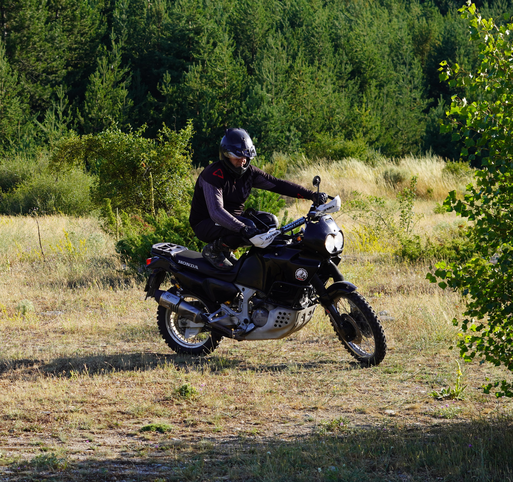
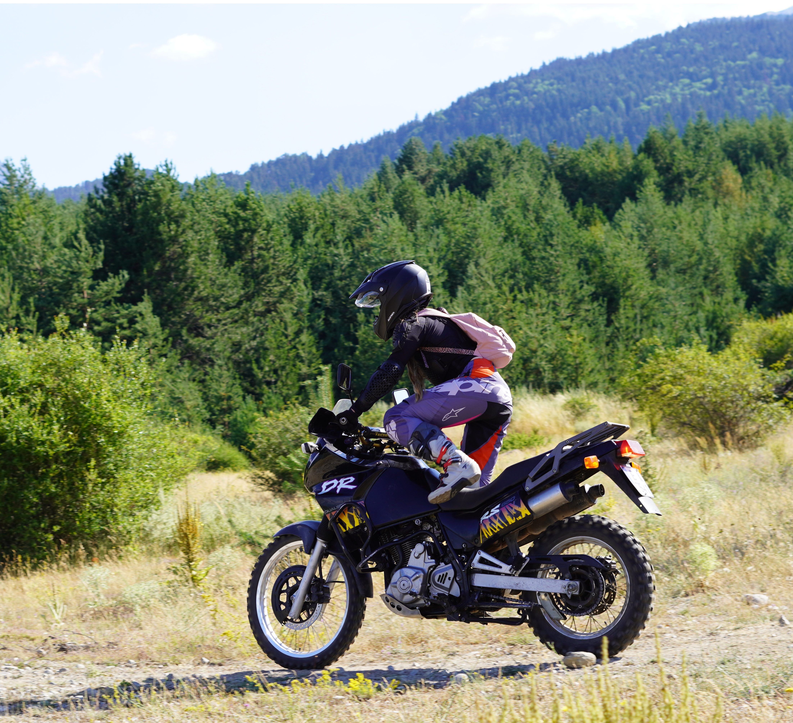
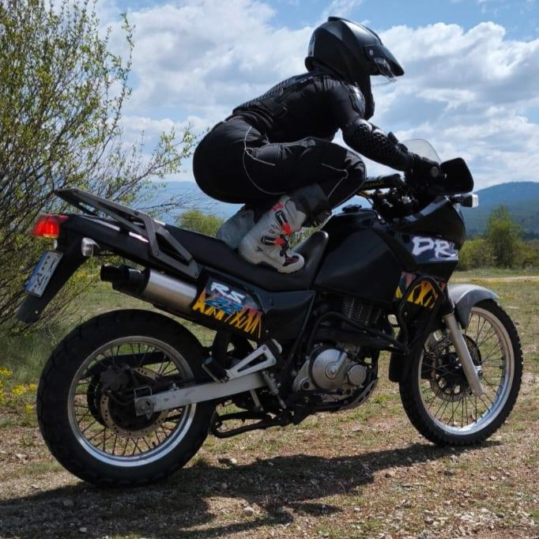
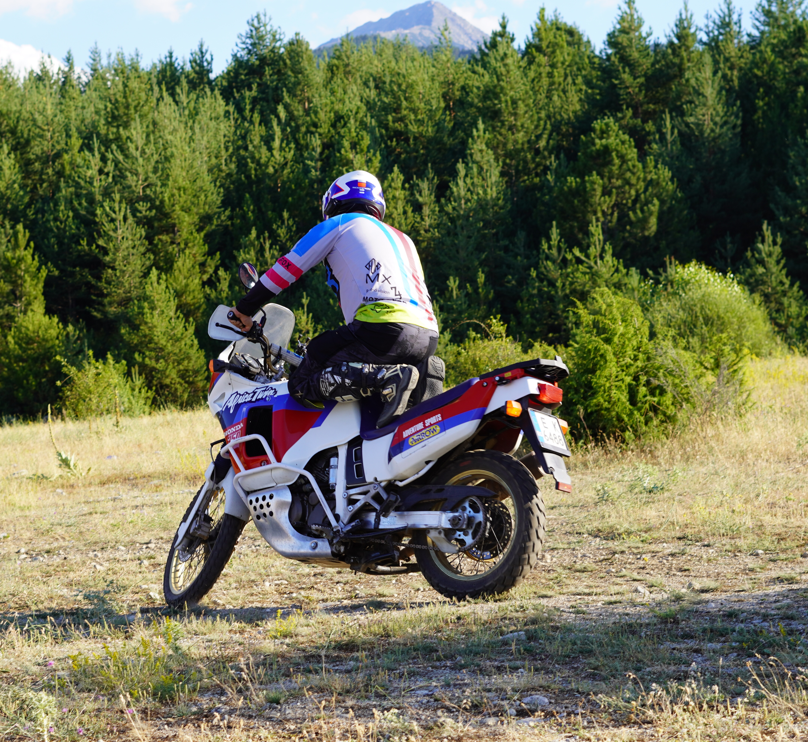
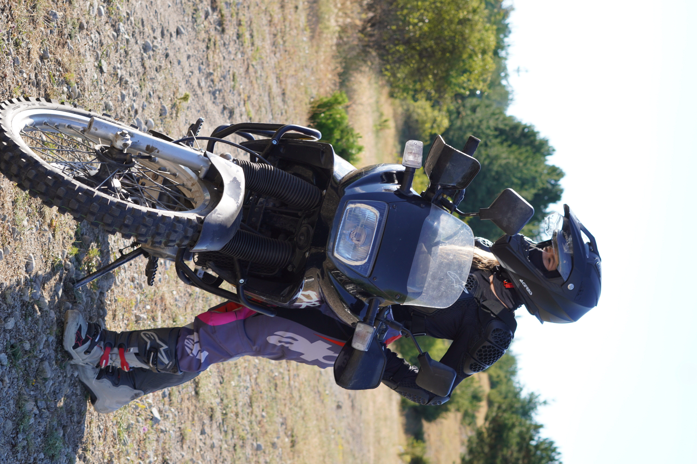

> **Executive Summary:** A reflexive death grip under front-wheel impacts or rut deflections can restrict the handlebar movement needed for the front wheel to track freely, increasing the risk of front-end washout or tuck on loose and slick terrain. Squat riding on the seat and one-handed standing drills train light hands, relaxed arms, balance, and control through the legs and body rather than through bracing on the bars. The progression moves from supported and stationary exercises to low-speed rolling drills and, only after control improves, uneven terrain.

# Let the Front Wheel Track: How to Stop Locking the Bars When the Trail Gets Rough

## 1. Why the Death Grip Causes Front-End Instability

### 1.1. The reflexive grip under impact

One common cause of off-road crashes is the rider's reflexive **death grip** on the handlebars when an obstacle strikes the front wheel—or sometimes the rear wheel—or when the front wheel drops into a rut. These events can occur on light enduro and motocross motorcycles, dual-sport motorcycles, and heavy adventure motorcycles.

When the rider clamps down on the bars, the front wheel is prevented from tracking freely. As lateral loads build, front-end traction can disappear. On loose or slick dirt, the front end may wash out or tuck rapidly, resulting in a crash and possible injury.

The mechanism described in the article can be represented as follows:

```text
Rock, root, or rut deflects a wheel
                |
                v
Unexpected motorcycle movement reaches the rider
                |
                v
Reflexive high-force grip on the handlebars
                |
                v
Handlebar movement and front-wheel tracking are restricted
                |
                v
Lateral loads build and front-end traction decreases
                |
                v
Front end washes out or tucks on loose / slick terrain
                |
                v
Loss of control, crash, or injury
```

### 1.2. Intentional control versus uncontrolled bracing

The objective is not to eliminate all contact with the handlebars or all arm activity. **Light damping with the arms** and **deliberate steering input** remain useful when appropriate. The skill is to distinguish intentional control from an uncontrolled grip reflex that restrains the steering.

Two related habits must be addressed:

- **Hanging off the bars** during acceleration or braking.
- **Locking the bars with a death grip** when the motorcycle is deflected by obstacles or terrain irregularities.

Both habits interfere with the rider's ability to let the motorcycle move underneath the body.

---

## 2. Core Riding Principle: Light Hands and a Mobile Body

From the beginning of training, riders should develop **light hands** and **relaxed arms**. The motorcycle must be able to move underneath the rider while balance and weight transfer are managed primarily through **body position**, **leg pressure**, and controlled movement of the body's mass—not by clamping down on the handlebars.

This principle applies in both riding positions:

- **Standing attack position:** the rider maintains relaxed arms and uses the legs and body to manage movement and balance.
- **Seated position:** the rider avoids using the handlebars as a brace and allows the motorcycle to move beneath the body.

During acceleration, the rider should avoid pulling on the bars. During braking, the rider should avoid bracing against them. On climbs and rough terrain, the same principle helps prevent the grip reflex from restricting front-wheel tracking.

### 2.1. Body movement and handlebar loading

The drills in this article are designed to shift the rider's control strategy away from excessive arm tension and toward coordinated body movement and leg engagement. The target is not a passive upper body, but an upper body that remains sufficiently relaxed to avoid transmitting unnecessary inputs to the handlebars.

---

## 3. Drill Architecture and Training Progression

The progression is built around two principal drill families:

1. **Squat riding on the seat** — the rider places both feet on the seat, adopts a low squat, and keeps the heels slightly raised. This challenges balance and makes excessive reliance on the handlebars more apparent.
2. **One-handed standing riding** — the rider performs standing drills while riding with one hand, reinforcing leg and core control and reducing dependence on the bars for support.

Squat riding is introduced on the flattest available ground at low speed. The rider first develops balance in supported and stationary conditions, then progresses to rolling drills, acceleration and braking, figure-eights, and eventually uneven terrain.

### 3.1. Progression overview

| Stage | Exercise | Conditions | Primary technical focus |
|---|---|---|---|
| 1 | One foot on the seat, one foot on the peg | Introductory posture familiarization | Become familiar with the squat-riding posture |
| 2 | Acceleration and braking with body timing | Smooth, straight stretch | Coordinate body movement with throttle and brake inputs while keeping light hands |
| 3 | Stationary squat balance with a coach | Motorcycle stationary; coach stabilizes the front end | Relax the arms and maintain balance during gentle side-to-side rocking |
| 4 | Stationary stepping sequence | Motorcycle stationary with coach support | Move between pegs and seat without tightening the arms |
| 5 | Rolling stepping sequence | Flat ground, minimal controlled speed | Preserve balance and light hands while moving between seat and pegs |
| 6 | Squat acceleration and braking | Controlled, progressively increased intensity | Manage forward and rearward body momentum without bracing on the bars |
| 7 | Slow figure-eights in a squat | Flat ground; steady throttle followed by throttle roll-on through transitions | Maintain balance and relaxed arms while changing direction |
| 8 | Squat drills on rougher terrain | Uneven ground with small rocks or roots, after basic control is established | Suppress the grip reflex and allow the front wheel to track |
| 9 | One-handed standing drills | Integrated into the riding warm-up | Reinforce leg and core control with light hands |

---

## 4. Squat Riding on the Seat

### 4.1. Initial adaptation on flat ground

At the first stage, the rider becomes comfortable riding in a squat position on the seat. Use the flattest available ground and begin at low speed. The rider places both feet on the seat, keeps the heels slightly raised, and maintains relaxed arms.



*Maximoff demonstrating slow figure-eights in a squat on his Honda Africa Twin XRV750 RD07 at the MaximoffADV training ground near Bansko. Rolling smoothly onto the throttle before each transition while staying loose on the bars keeps the front end predictable instead of fighting the steering.*

Although standing or squatting on the seat may look intimidating to beginners, the source describes it as manageable on a flat surface at low speed with appropriate coach or spotter support. This should not be interpreted as a guarantee of a safe step back onto the footpegs at higher speed or on rough terrain. Begin in controlled, flat conditions.

### 4.2. Lead-up drills

#### 4.2.1. One foot on the seat, one foot on the peg

While standing on the motorcycle, the rider places one foot on the seat and keeps the other foot on the footpeg. This is an introductory position intended to help the rider adapt to the posture before attempting a full squat on the seat.

#### 4.2.2. Acceleration and braking with body timing

On a smooth stretch, the rider coordinates proactive body shifts with throttle and brake control.

**Acceleration sequence:**

1. Allow the body to move forward with the change in acceleration.
2. Apply the throttle smoothly—described in the source as *cracking the throttle*—so the body returns toward a neutral position.
3. Hold a steady throttle for approximately **five seconds** between the acceleration and braking phases.

**Braking sequence:**

1. Roll off the throttle.
2. Apply the front brake progressively.
3. As momentum carries the body forward, shift body weight back toward the heels.
4. Allow the braking force to bring the rider back to a balanced, neutral stance.

Increase intensity gradually by using more decisive body movement and firmer throttle and brake inputs.

**Key focus:** Keep the hands light and the arms relaxed so the front wheel can track and find its line without the rider fighting the handlebars.

#### 4.2.3. Stationary balance with a coach

The coach stands in front of the motorcycle, holds the front wheel between their legs, and steadies the handlebars. The rider steps onto the seat, adopts a squat, and works on relaxing the arms.

Once the rider is balanced:

1. The coach gently rocks the motorcycle from side to side while the rider remains loose on the handlebars.
2. The rider lightly touches the coach's forearms or shoulders with the index fingers. This contact is used strictly as a balance reference during gentle side-to-side rocking.
3. The rider then attempts to maintain the squat balance without using the hands for support.

#### 4.2.4. Stationary stepping drill

With the coach supporting the motorcycle from the same starting position, the rider practices a four-step sequence:

**Right-foot lead:**

1. Right foot onto the seat.
2. Left foot onto the seat, moving into a squat.
3. Right foot back onto the footpeg.
4. Left foot back onto the footpeg.

On the next cycle, reverse the lead side:

**Left-foot lead:**

1. Left foot onto the seat.
2. Right foot onto the seat, moving into a squat.
3. Left foot back onto the footpeg.
4. Right foot back onto the footpeg.

Perform at least **10 full cycles per set**, for **4–6 sets**, with **1–1.5 minutes of rest** between sets. Keep the arms loose throughout the sequence.

#### 4.2.5. Rolling stepping drill

After the stepping sequence becomes consistent on a stationary motorcycle, repeat the same foot sequence while rolling. Keep the hands light and reduce speed gradually toward the lowest speed that remains controlled, without locking the handlebars.



*Tanya Derdei practicing the rolling stepping drill on her Suzuki DR650 RSE near Bansko. Even on a heavier dual-sport motorcycle, moving between the pegs and the seat at low rolling speed trains balance without clamping down on the bars. The drill should first be practiced on flat ground at minimal speed.*

---

## 5. Core Squat-Riding Drills

### 5.1. Squat acceleration and braking

The rider begins by initiating a forward body shift, described in the source as moving almost as if falling toward the handlebars. Smooth throttle application then brings the body back toward neutral as the motorcycle accelerates.

For braking:

1. Shift body weight back toward the heels.
2. Roll off the throttle.
3. Squeeze the front brake to manage the forward momentum.
4. Return to a balanced, neutral squat stance.

Progress gradually toward near-stops and then full stops during braking. During acceleration, progress toward a light front-wheel lift.



*Tanya Derdei practicing squat acceleration and braking on her Suzuki DR650 RSE near Bansko. Initiating weight shifts with the body before applying throttle or front brake helps manage momentum while keeping the hands light on the bars, including on a heavy dual-sport motorcycle.*

### 5.2. Slow figure-eights in a squat

Begin on steady throttle. Then transition to rolling on the throttle ahead of each turn or change of direction.

Maintain relaxed arms throughout the figure-eight. A light rear-wheel slide under throttle is acceptable when it remains controlled.



*Deyan learning slow figure-eights in a squat position on his Honda Africa Twin XRV750 near Bansko. Balancing a full-size adventure motorcycle on the seat while turning requires light hands and body-weight shifts rather than forcing the steering lock.*

### 5.3. Progression to rougher terrain

As control improves, move the squat-riding drills onto uneven ground containing small rocks or roots.

The objective is to suppress the reflexive grip response and develop automatic body reactions that allow the front wheel to track cleanly. The move to rougher terrain comes after the rider has developed control in the preceding low-speed and flat-ground exercises.

---

## 6. One-Handed Standing Riding

Alongside squat riding, one-handed standing drills reinforce **leg and core control**. The rider grips the motorcycle firmly with the legs while keeping the hands light on the handlebars.

The source specifies the following drill sequence:

1. Acceleration while standing and riding one-handed.
2. Braking while standing and riding one-handed.
3. Figure-eights on steady throttle while standing one-handed.
4. Figure-eights while rolling on the throttle through direction changes, standing one-handed.

Maintain the **shins close to vertical** and avoid allowing the knees to shoot forward. Grip firmly with the legs while keeping the hands light on the bars.

---

## 7. Warm-Up Integration and Transfer to Off-Road Riding

Integrating the squat-riding and one-handed standing sequences into a warm-up is intended to reduce the risk of a reflexive death grip and improve control during:

- acceleration;
- braking;
- hill climbs;
- steep descents on loose or rough dirt.

The same control strategy is relevant to **motocross whoops**. The rider must be able to damp handlebar movement appropriately and react more quickly when the motorcycle begins to kick sideways or cross-rut.

Short pauses between balance drills allow attention and focus to reset so that the next repetition begins without rushing or unnecessary tension.



*Tanya Derdei taking a rest break beside her Suzuki DR650 RSE near Bansko. Short pauses between balance drills let attention and focus reset so the next repetition starts clean rather than rushed or tense.*

---

## 8. Technical Cues and Training Priorities

The drills are organized around a small number of recurring control priorities:

| Technical priority | Rider action | Intended result described in the source |
|---|---|---|
| **Light hands** | Avoid clamping down on the handlebars | Allow the front wheel to track and find its line |
| **Relaxed arms** | Avoid pulling on the bars during acceleration or bracing against them during braking | Reduce unnecessary handlebar inputs |
| **Body-weight transfer** | Coordinate forward and rearward body movement with throttle and brake inputs | Manage body momentum while maintaining balance |
| **Leg engagement** | Use leg pressure to hold and control the body position | Reduce dependence on the handlebars for support |
| **Controlled progression** | Move from supported and stationary drills to low-speed rolling exercises | Establish balance before increasing task demands |
| **Terrain progression** | Introduce small rocks and roots after basic control improves | Practice allowing the front wheel to track over irregular terrain |
| **Intentional steering and damping** | Use deliberate steering input or light arm damping when required, without a reflexive death grip | Preserve the distinction between purposeful control and uncontrolled bracing |

The central training objective is not to stop using the handlebars. It is to stop using a high-force, reflexive grip as the primary response to motorcycle movement. The rider develops the ability to maintain balance through the body and legs while allowing the front end the freedom to track the terrain.
