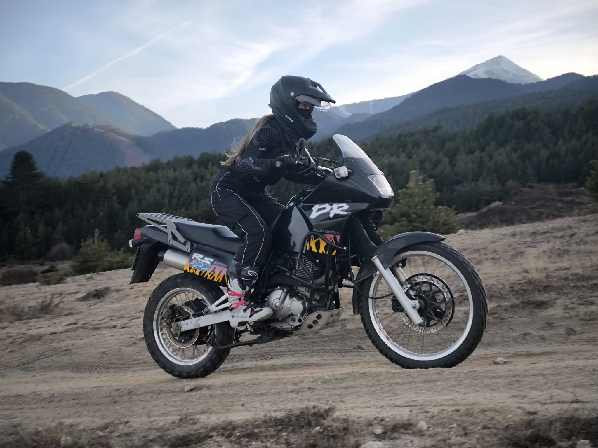

# Off-Road Control for Heavy Adventure & Dual-Sport Riders

**Motocross biomechanics adapted for real-world travel — ride longer, safer, and without lower-back pain.**

You don’t need to muscle a 220-kg adventure bike through rough terrain. When your skeletal structure, foot-peg weighting, and bar control work with the motorcycle instead of against it, fatigue drops and traction becomes predictable.

I offer **1-on-1 coaching and private group training (up to 5 riders)** on your own motorcycle in Bansko, Bulgaria—from closed-ground fundamentals to multi-day mountain field coaching. No mixed groups of strangers, no artificial adrenaline, and no travel-agency commissions. Just practical technique built for riders who want to go further and arrive intact.

- [Discuss Your Goals & Check Availability](/contact)
- [Explore Training & Riding Formats](/training-and-rides)

*Closed-ground mechanics in action: riding a Suzuki DR650 on a training ground with the Pirin mountain range behind—body alignment and balance replace brute force.*

---

## Who This Is For

This program is open to riders of all ages on dual-sport and heavy adventure motorcycles—with specialized coaching for older and mature riders—who value mechanical sympathy, physical longevity, and predictable control over reckless speed.

### 1. Street Riders Transitioning to Off-Road
You are comfortable on pavement, but loose gravel, ruts, off-camber turns, and steep mountain grades make your motorcycle feel top-heavy and unpredictable. You want a structured, logical progression that builds real control from the ground up—without being thrown into terrain you are not ready for.

### 2. Experienced Adventure Riders Looking for Efficiency
You already travel off-pavement, but you finish riding days exhausted—hanging onto the handlebars, overloading your lower back, and fighting the weight of the bike. You want to replace brute force with proper motocross-derived biomechanics so you can ride technical terrain for days without physical burnout.

---

## How the Coaching Works

> **1-on-1 or Pre-Formed Private Groups Only (Max 5 Riders)**  
> For core coaching sessions, I do not assemble mixed groups of strangers. You work either 1-on-1 or bring your own pre-formed group of up to 5 friends or riding partners. Keeping training groups private and familiar eliminates ego-driven pace pressure, keeps the rhythm consistent, and ensures every rider gets direct, individual feedback.

Exact training plans are never locked in blindly in advance. We start with practical diagnostic drills on your own bike to identify real tension points and balance gaps, then progress logically from closed ground to live mountain terrain:

- **Skeletal alignment & attack position:** Locking into the bike with your lower body so your hands stay light on the controls.
- **Clutch, throttle, and braking modulation:** Precise traction management on loose rock, ruts, and tight mountain turns.
- **Low-speed balance & safe bike recovery:** Handling heavy motorcycles in confined spaces and lifting a fallen 200+ kg bike using proper leverage without injuring your back.
- **Terrain reading & fatigue management:** Maintaining clean posture, breathing, and line selection across steep climbs, descents, and multi-day mountain stages.

### Coaching & Riding Formats
Depending on your timeline and goals, we work across several formats:
- **Training Ground Sessions (1–2 Days)** & **Weekend Training Rides (1–2 Days)**
- **Multi-Day Field Coaching (3+ Days)** across the Rhodope and Rila mountains
- **Custom Multi-Day Training Camps (5–21 Days)** for private groups of 2–5 riders (billed strictly for active training days; rest days are unbilled)
- **Bi-Weekly Open Practice Rides (5+ Riders)** & **Route Reconnaissance** *(for vetted riders)*

- [View Full Details on All Training & Riding Formats](/training-and-rides)

---

## Training Base: Bansko, Bulgaria

All sessions are based in **Bansko**—a mountain valley hub giving direct access to hundreds of kilometers of legal unpaved dirt roads, forest tracks, and technical climbs across the **Rhodope Mountains** and designated sections of **Rila** (strictly respecting Pirin National Park boundaries).

After riding, Bansko provides thermal mineral hot springs, sports massage, full repair infrastructure, and independent accommodation across every budget—with zero agency markups.

- [Why Bansko: Training Base, Terrain & Rider Logistics](/location-and-logistics)

---

## Discuss Your Goals & Check Availability

There is no automated cart or instant checkout. Every coaching block or mountain training ride starts with a direct conversation to match the format, terrain, and schedule to your motorcycle and current background.

- [Go to Inquiry Checklist & Copy-Paste Template](/contact)
- **Email:** exhilaration.zone@gmail.com
- **WhatsApp / Telegram:** +359 ...
